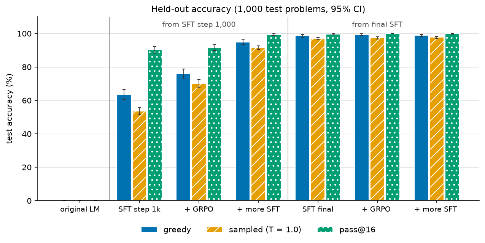
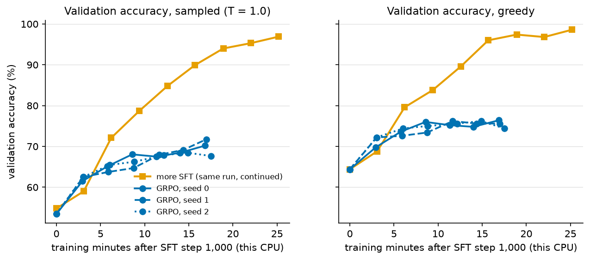
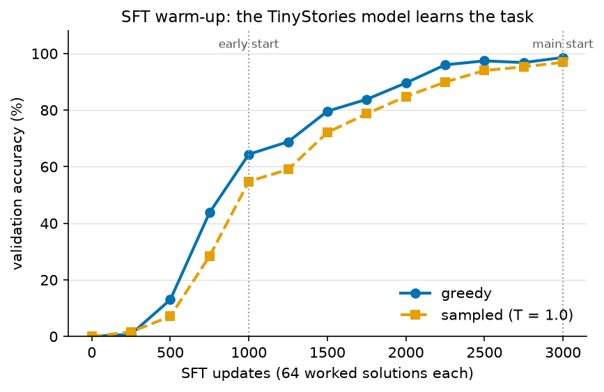
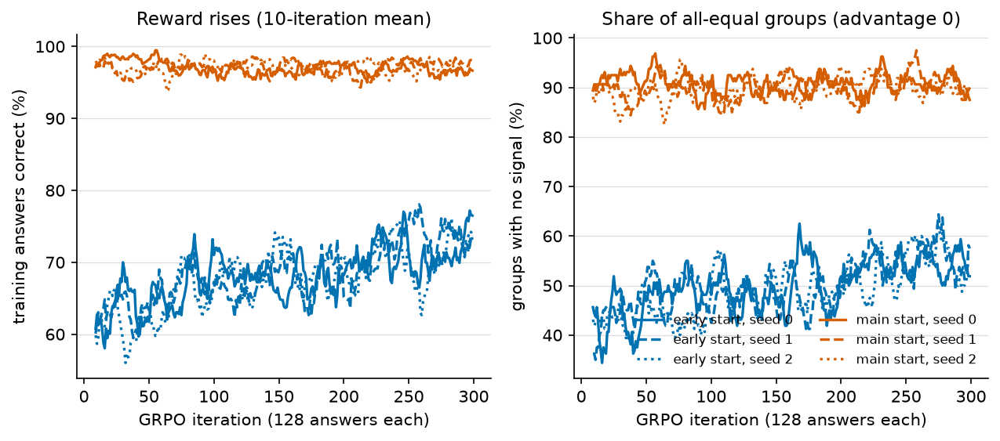
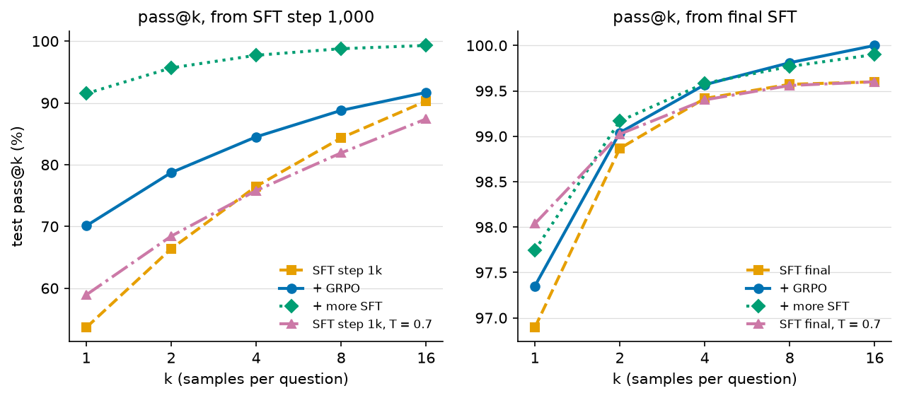
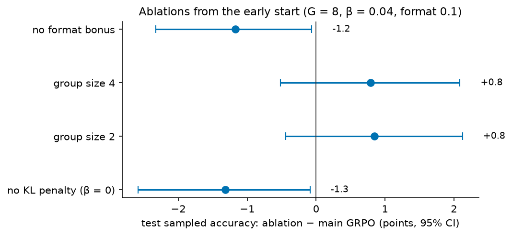
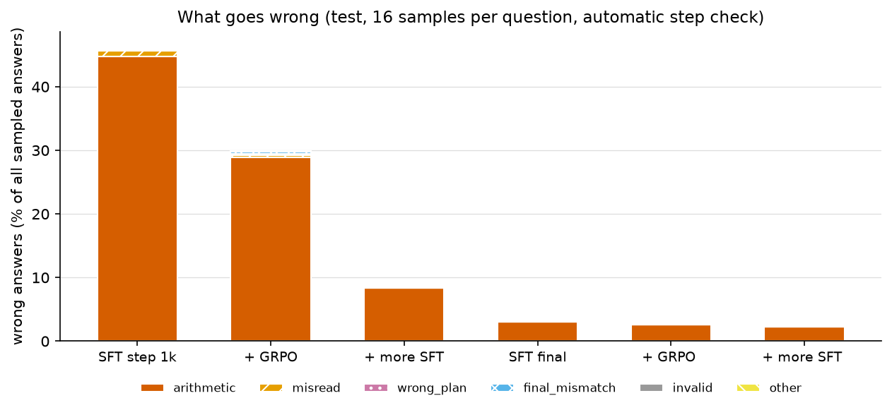

# GRPO Post-Training of a Small Language Model

Project 8 of a series on small language models. It takes Project 1's small GPT (13.9M parameters, trained only on
TinyStories) and post-trains it to solve simple arithmetic with **Group Relative Policy Optimization (GRPO)**, the
reinforcement-learning method behind recent reasoning models. Every answer can be checked automatically, so the reward
is just "is the final number right?" (+ a small bonus for a well-formed answer). Everything runs on a CPU and is
written by hand in PyTorch (no RL library).

**Research question:** under a fixed compute budget, can GRPO improve a small model's answer accuracy relative to
supervised fine-tuning (SFT) and the original model?

**Short answer:** GRPO works, but on this task supervised training is the better use of compute.
* The original model gets **0%**: it cannot even produce an answer, so GRPO has nothing to reinforce. A short SFT
  warm-up on worked solutions is required first.
* From a half-trained SFT model (54% sampled accuracy), GRPO adds **+15 to +16.5 points** (3 seeds, every 95% CI > 0),
  more than lowering the sampling temperature gives (+11 over T = 0.7), and greedy accuracy rises too (+10 to +12.5).
* But spending the **same wall-clock time on more SFT** gives **+38 points**: GRPO is **21–23 points behind** at matched
  compute (every seed).
* From the fully trained SFT model (96.9%) about 89% of GRPO's answer groups are all-correct, so there is almost no
  learning signal: GRPO changes nothing measurable (−0.2 to +0.5 points), slightly loses to more SFT, and loses to
  simply sampling at temperature 0.7.



## Results (1,000 held-out test problems; 1 greedy answer + 16 samples at T = 1.0 each)

| System | Greedy | Sampled | pass@16 |
|---|---|---|---|
| Project 1 model (no post-training) | 0.0% | 0.0% | 0.0% |
| SFT, 1,000 updates | 63.6% | 53.6% | 90.3% |
| **+ GRPO** (3 seeds) | **73.6–76.1%** | **68.7–70.1%** | 91.7–93.1% |
| + more SFT, same time instead | 94.9% | 91.5% | 99.3% |
| SFT, 3,000 updates (final) | 98.7% | 96.9% | 99.6% |
| **+ GRPO** (3 seeds) | 98.2–99.3% | 96.7–97.4% | 99.6–100% |
| + more SFT, same time instead | 98.9% | 97.7% | 99.9% |
| final SFT sampled at T = 0.7 | – | 98.0% | 99.6% |

Sampled = mean correctness over 16 samples (what GRPO optimises). pass@16 = at least one of 16 samples right.
Differences are paired by question with 95% bootstrap intervals; full tables and every hypothesis verdict (written
before any test result) are in `INSTRUCTIONS.md`, Phases 12–15.



### What we learned
1. **RL needs a model that is sometimes right.** GRPO compares several answers to the same question; if they all get
   the same reward, the advantages are zero and nothing is learned. The original model (0%) and the final SFT model
   (97%) both give almost no signal. GRPO only had something to work with in between.

   

   *The SFT warm-up teaches the TinyStories model the task (validation accuracy from 0% to
   about 98%). GRPO was started from two points on
   this curve: the "early start" (1,000 updates) and the "main start" (3,000).*

   

   *Left: from the early start (blue) the training reward rises from about 60% to 75% over 300 iterations; from the
   main start (orange) it is already near 97% and stays there. Right: around 90% of the main start's answer groups are
   all-equal and give no learning signal, against 40–60% for the early start.*
2. **Dense supervision beats sparse reward when demonstrations are cheap.** SFT learns from every token of a correct
   worked solution; GRPO learns one number per answer, and only from groups with mixed results. Here correct solutions
   cost nothing to generate, so imitation wins by a wide margin.
3. **GRPO does real learning, not only sharpening, when there is signal.** From the early start it beats a lower
   temperature and improves greedy accuracy; pass@16 also rises a little (+1.4 to +2.8).

   

   *Left: from the early start GRPO (blue) beats a lower temperature (pink) at every k, but more SFT (green) beats
   both. Right: from the final SFT model all systems are within about one point.*
4. **One seed is not enough for an ablation.** The three identical GRPO runs span 1.4 points. Against seed 0 alone,
   removing the format bonus or the KL penalty looks significantly worse; against seeds 1 and 2 it makes no difference.
5. **Ablations (early start, same 38,400 responses):** the format bonus is unnecessary once SFT gives 100% valid format;
   *smaller* groups (2 or 4 answers × more questions) were 0.8–2.3 points *better* than 8 answers per question; and the
   KL penalty did nothing: the policy moved the same distance (KL 0.017 per token) with or without it.

   

   *Each ablation against GRPO seed 0 only. The three identical GRPO seeds already differ by 1.4 points, so none of
   these effects is larger than seed noise (finding 4).*
6. **Errors are arithmetic, not reasoning.** About 97% of wrong answers set up the right steps but compute one wrongly
   (`8 + 87 = 85`). GRPO reduces how often that happens but not what kind of error it is. "Lucky" correct answers
   from wrong steps are rare (1–2%) and became *rarer* after GRPO: no reward hacking.

   

   *Wrong answers as a share of all sampled answers, by error type: almost all are arithmetic slips (orange).*
7. **Cost:** a GRPO run is 38,400 sampled answers in 10–17 minutes on this CPU (2.5–3.8 GB RAM). Inference cost is
   unchanged (about 65–70 ms per answer at batch 1) because GRPO does not change answer length.

## Repository

```
grpo/                the code
  tasks.py           5 arithmetic problem families, hash-based train/val/test split (no overlap)
  dataset.py         100k train, 500 val, 1,000 test problems
  prompts.py         "Question: ... Solution:" prompt and worked-solution target
  answer_parser.py   strict parser for <answer>N</answer>
  rewards.py         1.0 x correct + 0.1 x valid format
  policy.py          load Project 1's GPT, KV-cached batched sampling, per-token log-probabilities
  advantages.py      group-relative advantages (reward - group mean) / group std
  grpo_loss.py       clipped surrogate + k3 KL to the reference, token-level averaging
  train_sft.py       the SFT warm-up and the matched-compute "more SFT" control
  train_grpo.py      the GRPO loop (sample -> score -> advantages -> clipped updates)
  evaluate.py        greedy + 16 samples, pass@k
  compare.py         paired bootstrap comparisons
  drift.py           KL(policy || reference) measured after training
  errors.py          automatic step-by-step error classification
  benchmark.py       latency, throughput, training cost
  plots.py           figures
configs/             SFT, learning-rate pilot, 10 GRPO runs, comparison pairs, pre-registered hypotheses
scripts/             env_report.py, lr_pilot.sh, train_all.sh, eval_all.sh
data/                the generated problems
results/             training logs, evaluations, generations, comparisons, error analysis, benchmark, figures
tests/               46 tests
project8.html        a tutorial explaining every phase
```
Checkpoints (`checkpoints/<run>/final.pt`, 55 MB each) are not committed; the scripts rebuild them.

## Reproduce

Windows, Python 3.12, CPU (about 6 h in total). The base model and tokenizer are read from the sibling folder
`../project1` (read-only).

```
python -m venv .venv
.venv\Scripts\activate
pip install -r requirements.lock.txt
python -m pytest -q
python -m grpo.dataset
python -m grpo.train_sft --config sft.yaml        # ~38 min
bash scripts/lr_pilot.sh                          # ~10 min
bash scripts/train_all.sh                         # 10 GRPO runs + more-SFT control, ~2.7 h
bash scripts/eval_all.sh                          # 17 systems on test, ~1 h
python -m grpo.compare --split test
python -m grpo.errors --split test --systems base sft_1000 grpo_early_s0 sft_mid sft grpo_s0 sft_extra
python -m grpo.drift --systems grpo_early_s0 grpo_early_s1 grpo_early_s2 early_beta0 early_nofmt early_g2 early_g4
python -m grpo.benchmark --systems base sft_1000=sft/step_01000 sft grpo_s0 grpo_early_s0 sft_extra --runs sft grpo_s0
python -m grpo.plots
```

`INSTRUCTIONS.md` walks through all 16 phases with the reasons for each choice.

## Limits
CPU only, one small model (13.9M parameters) and one narrow synthetic task where correct demonstrations are free;
GRPO's advantage in practice comes from tasks where they are not (no worked solutions, or many valid solutions).
GRPO ran 300 iterations at a conservative learning rate (1e-5; 1e-4 collapsed in the pilot); longer or faster
training could change the ablation results, especially for the KL penalty. Ablations use one seed each and their
effects are about the size of the seed-to-seed spread. The matched-compute rule matches wall-clock time on this PC;
it slightly favours GRPO (the more-SFT controls got 7–9% less time). The temperature-0.7 control was added for
interpretation and is not a pre-registered hypothesis.
